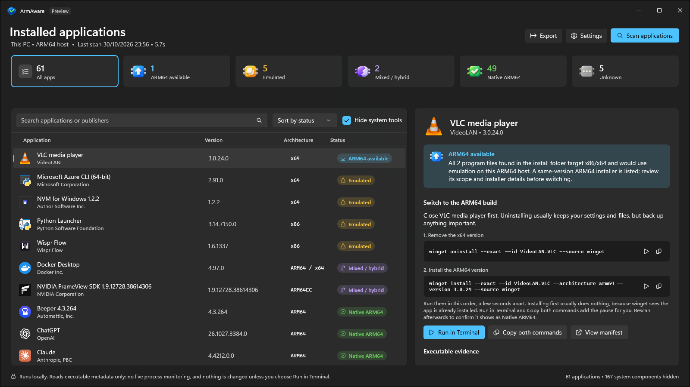

<p align="center"></p>

<h1 align="center">ArmAware</h1>

<p align="center"><strong>Find the apps on your Windows on ARM PC that run under emulation, and switch them to native ARM64.</strong></p>

<p align="center">
  <a href="https://apps.microsoft.com/detail/9N84PT3981Z1?mode=direct">
    <picture>
      <source media="(prefers-color-scheme: dark)" srcset="https://get.microsoft.com/images/en-us%20light.svg">
      
    </picture>
  </a>
</p>

<p align="center"><a href="https://thesirlan.github.io/ArmAware/">Website</a> · <a href="https://thesirlan.github.io/ArmAware/privacy.html">Privacy</a> · <a href="https://github.com/TheSirLan/ArmAware/issues">Issues</a></p>

<p align="center"></p>

ArmAware is a free, open-source Windows 11 utility for ARM64 PCs. It inventories your installed apps, reads each program file's own headers to see whether it is ARM64, x64, x86 or a hybrid, and tells you when a matching ARM64 build is available. It never runs the files it inspects, and it only changes an app when you ask it to and confirm the exact Winget commands.

## Why it exists

I built ArmAware after picking up a Surface Laptop Ultra and realising how easy it was to end up running x64 apps without knowing, even when a native ARM64 build existed.

On a Windows on ARM PC it is surprisingly easy to install the wrong build of an app. Many download pages detect that you are on Windows but not which processor you have, so the big "Download for Windows" button often hands you the x64 installer, even when the developer publishes a native ARM64 one a link further down the page. Installers and updaters then tend to keep you on whichever architecture you started with.

Nothing warns you, because Windows quietly runs x86 and x64 apps through emulation and they mostly just work. The cost is hidden: an emulated app can use more battery and feel slower than its native build would. Most people never find out which of their apps are affected.

ArmAware answers that question for the apps you already have.

## Features

- **Clear status for every app:** Native ARM64, ARM64 available, Emulated, Mixed (ARM64EC/ARM64X or differing files) or Unknown, with the evidence behind each result.
- **Two-step switch:** for an emulated app with a same-version ARM64 installer, ArmAware shows the Winget commands to uninstall the x64 build and install the ARM64 one. Copy them, or run them in a visible terminal after a confirmation.
- **Winget updates:** apps with a newer version in the Winget catalog are flagged, with the upgrade command ready.
- **Broad inventory:** desktop apps from the registry (machine and user, 64-bit and 32-bit views), current-user MSIX and Store packages, and Windows Installer component records.
- **Offline by default:** online checks are optional and go through Windows Package Manager, with a seven-day local cache.
- **Native WinUI 3 app** with Mica, light and dark themes, search, filters, a details pane and JSON/CSV export, plus a command-line interface that uses the same scanner.

## Install

Get ArmAware from the [Microsoft Store](https://apps.microsoft.com/detail/9N84PT3981Z1). The Store version is signed and updates automatically.

## Requirements

- Windows 11 (build 22000 or later) on an ARM64 PC.
- [App Installer](https://apps.microsoft.com/detail/9NBLGGH4NNS1) (Windows Package Manager) for online checks and switch commands. ArmAware checks for it on first run.

## Build from source

Install the .NET 10 SDK (`global.json` selects 10.0.403 with feature-band roll-forward). The WinUI and Windows SDK dependencies restore from NuGet, so Visual Studio is optional.

```powershell
dotnet restore ArmAware.slnx
dotnet build ArmAware.slnx -c Release
dotnet test tests/ArmAware.Tests -c Release
dotnet build src/ArmAware.App -c Release -p:Platform=ARM64
```

Run the desktop app:

```powershell
& ./src/ArmAware.App/bin/ARM64/Release/net10.0-windows10.0.26100.0/win-arm64/ArmAware.App.exe
```

The app and CLI build for ARM64 only. Inspection of x86 and x64 files is fully supported, since that is how emulated apps are found. See [packaging](docs/packaging.md) for self-contained folders and [MSIX packaging](docs/msix-packaging.md) for the Store package.

## Command line

```powershell
dotnet run --project src/ArmAware.Cli -- info
dotnet run --project src/ArmAware.Cli -- scan
dotnet run --project src/ArmAware.Cli -- scan --upgrades-only --online
dotnet run --project src/ArmAware.Cli -- scan --format json > scan.json
dotnet run --project src/ArmAware.Cli -- scan --format csv > scan.csv
dotnet run --project src/ArmAware.Cli -- inspect C:/path/to/application.exe
dotnet run --project src/ArmAware.Cli -- package Microsoft.VisualStudioCode 1.105.1
```

Other scan flags: `--no-cache`, `--no-packaged` and `--machine-only`. Reports go to stdout and logs to stderr. Exit codes: 0 success, 1 fatal failure, 2 invalid arguments, 3 package or version not found, 130 cancelled.

## How it works

| Project | Responsibility |
| --- | --- |
| `ArmAware.Core` | Domain records, scan orchestration, classification, switch commands, report export |
| `ArmAware.Windows` | Registry, MSIX and Windows Installer inventory, executable location, PE inspection, Windows Package Manager integration |
| `ArmAware.Winget` | ARM64 availability decisions from catalog data; manifest reader for the `package` diagnostic |
| `ArmAware.Cli` | Command-line interface and shared service registration |
| `ArmAware.App` | WinUI 3 views and view models |
| `ArmAware.Tests` | Unit and integration tests |

Files are inspected with `PEReader` and never loaded or executed. Package architecture never stands in for executable evidence. A recommendation needs x86/x64 evidence for the app's program files and an ARM64 installer for the exact installed version and scope. When the evidence is not strong enough, the result stays Unknown. See the [engineering notes](docs/engineering.md) and [Store integration notes](docs/microsoft-store.md) for details.

## Privacy

No account, telemetry, backend, startup task or background service. Scans are local and offline by default.

When online checks are on, Windows Package Manager queries Microsoft's Winget source (`cdn.winget.microsoft.com`) and, for Store apps, the Microsoft Store source (`storeedgefd.dsx.mp.microsoft.com`). Those requests can include package IDs, versions, package family names, product codes and market information, plus your IP address. No inventory file is uploaded. The "Search for an ARM64 build" button opens a Bing search containing the app's name, only when you click it.

Settings and the catalog cache live in `%LOCALAPPDATA%\ArmAware`. Exports contain app names, versions and install paths, so review them before sharing. See the full [privacy policy](docs/privacy.html).

## Known limitations

- ArmAware reports what the inspected files are built for. It does not inspect dependencies, plugins or the processes actually running, and it does not promise that switching will be faster.
- An app's main program is identified by matching file product names to the app name, by Windows Installer records and by a one-off snapshot of running program paths. When several program files agree on one architecture, the result is inferred at medium confidence. Some apps remain Unknown.
- Managed AnyCPU files are architecture-neutral; mixed-mode managed files stay Unknown.
- MSIX inventory covers the current user only. No elevation is requested.
- Winget results depend on Windows Package Manager linking the installed app to its catalog. Apps it does not link stay unresolved, and a missing ARM64 entry does not prove that no ARM64 build exists.
- Builds you make from source are unsigned, so SmartScreen or App Control may block them. Use the Store version for a signed install.

## Contributing

Bug reports and pull requests are welcome. Read [CONTRIBUTING.md](CONTRIBUTING.md) first, and when reporting a wrong result, share redacted evidence rather than a full inventory export. See the [support page](https://thesirlan.github.io/ArmAware/support.html) for what to include. Report security problems privately as described in [SECURITY.md](SECURITY.md).

## License

[MIT](LICENSE)
